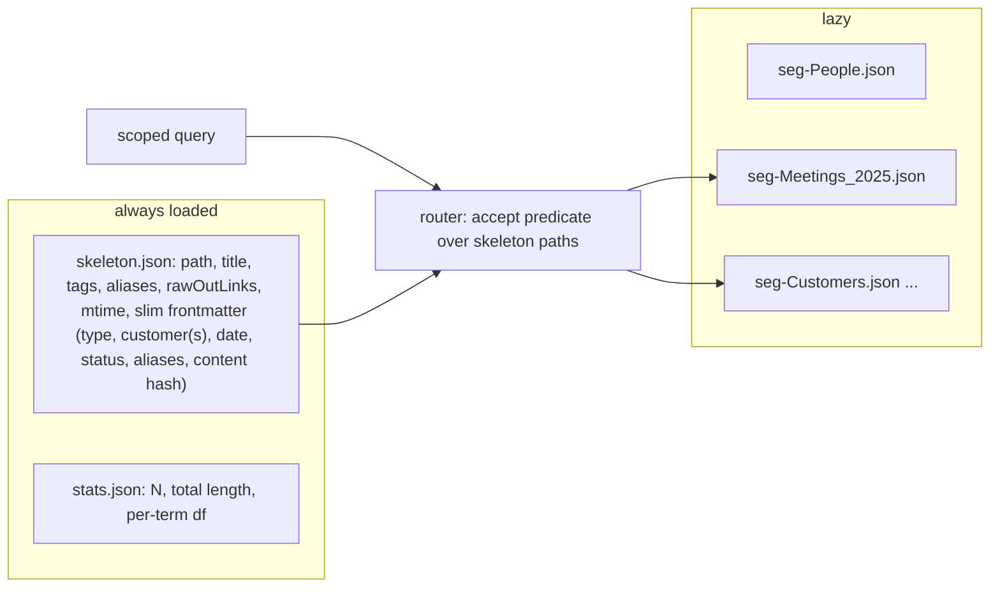

# Graph segmentation prototype: skeleton + lazy segments

> **Status: MEASURED. Verdict: GO for B (skeleton + lazy segments), preferably with the finer B2 segment policy.**
> Measured at 1.4k, 3k, 5k and 7.6k notes, with 5 runs each. The 15k run ran out of memory in the benchmark process before it wrote results (see §1).
> GO rests on flush bytes (−82 % for B, −88 % to −90 % for B2) with 100 % link parity and top-10 Jaccard 1.000 at every size and checkpoint. Only B2 also clears the 30 % warm bar.
> Segmentation does not fix the 0.9.4 startup problems (watcher readiness, the `get_customer_context` scan); see §8.
> The tables in §7 are generated by `aggregate.mts` from `results-<size>.json`. §8 states the findings.

## 1. Run history and scope

- **First blocked, then unblocked.** The runtime's permission system first blocked the run: it denied stripping `OBSIDIAN_VAULT_PATH`/`OIL*` and denied running without stripping. A person then ran the harness with a literal `--size N`. `Number("N")` is `NaN`, so the fixture generated zero people and crashed at `fixtures.mts:257`. The harness now rejects any `--size` that is not an integer ≥ 500 (exit code 2 with a usage message), and `--runs`/`--mass-runs` must be integers. With the user's approval the benchmark then ran with the vault and OIL variables removed from the shell.
- **Runs.** One shakeout run at 1.4k, then 1.4k, 3k, 5k and 7.6k at 5 runs each, run sequentially on this shared Windows ARM64 machine. Each size took 15–35 minutes.
- **15k did not complete.** With 3 runs it finished the cold, parity, warm, steady-state and edit phases. Then the benchmark process hit V8's default 4 GB heap limit in the mass-invalidation phase ("Ineffective mark-compacts near heap limit") and exited with code 134 before writing `results-15000.json`. One process holds the A, B, B2 and C instances plus per-run fresh instances, so this is a harness limit, not a measurement of a single production server. The 15k persisted sizes it logged before the crash were A 82.0 MB, B total 85.5 MB (skeleton 5.9 MB, stats 859 KB, largest segment `seg-People` 28.8 MB) and B2 largest segment 7.9 MB. Its parity at the cold checkpoint was B links 100 %, Jaccard 1.000; C links 43.9 %. The fatal abort skipped the harness's `finally` cleanup, so the leftover `%TEMP%\oil-shard-15000-*` vault was deleted by hand. The result was already decisive at 5k and 7.6k, because the flush gain is structural (§8), so 15k was not rerun.
- **Safety.** No `src/` file was modified. All vaults were synthetic, under `%TEMP%`, and deleted afterwards. A read-only check found that none of the `src/` modules the bench imports read `process.env`: `graph`, `bm25`, `vault`, `sidecar-sync`, `archive-policy`, `frontmatter` and `types`.

## 2. How to run

One harness run takes about 15 min at 1.4k notes and 25–35 min at 3k–7.6k on this machine, so start with a small dry run. Use PowerShell from the repository root. No `npm install` is needed, because a custom loader runs the real `src/*.ts` on Node's built-in type stripping (Node ≥ 23; developed against Node 26). `--size` must be a literal integer ≥ 500, such as `--size 5000`; a placeholder like `N` exits with code 2. At 15k, raise the heap (`node --max-old-space-size=8192 ...`) or the process runs out of memory in the mass phase.

```powershell
# Remove vault/OIL variables from THIS shell only.
Get-ChildItem Env: | Where-Object { $_.Name -eq 'OBSIDIAN_VAULT_PATH' -or $_.Name -like 'OIL*' } |
  ForEach-Object { Remove-Item "Env:$($_.Name)" }

# 0. Smoke test and dry run (minutes).
node --import ./bench/sharding/loader/register.mjs bench/sharding/smoke.mts
node --expose-gc --import ./bench/sharding/loader/register.mjs bench/sharding/harness.mts --size 1400 --runs 2

# 1. Full run: one process per size; writes bench/sharding/results-<size>.json.
foreach ($n in 1400, 3000, 5000, 7600, 15000) {
  node --expose-gc --import ./bench/sharding/loader/register.mjs bench/sharding/harness.mts --size $n --runs 5
}

# 2. Merge into results.json, compute the verdict and crossover, and refresh the tables below.
node bench/sharding/aggregate.mts
```

Each harness run creates one synthetic vault under `%TEMP%\oil-shard-<size>-*`. It refuses any root outside the OS temp directory, or any path containing `OneDrive` or `Obsidian`, and deletes the vault in a `finally` block. `--mass-runs N` can lower the mass-invalidation repetitions at 15k notes if the full run is too slow.

## 3. Question and decision rule

Is a small, always-loaded **skeleton** plus lazily loaded **segments** faster or cheaper than today's single `_oil-graph.json` at 1.4k–15k notes? And what does it cost to go further, to fully independent per-folder graphs?

**GO for B** requires all of the following at ≥ 5k notes:

- Either a **≥ 30 % faster** warm-load-to-first-scoped-answer, or **≥ 50 % fewer bytes** written per single-note flush.
- **100 %** forward-link and backlink set parity with A, for every note, at every checkpoint.
- A mean top-10 Jaccard of **≥ 0.9** against A.

Otherwise the result is **NO-GO**. `aggregate.mts` applies this rule mechanically.

- **Primary warm metric:** `S1b+reval`, defined as load + stat revalidation + the first customer-neighbourhood search. That is what a restarted server does before its first scoped answer.
- **Flush metric:** median bytes across 10 edit targets × runs.
- **Crossover:** the smallest tested size from which every larger tested size passes.

## 4. Method

### Fixtures (`fixtures.mts`)
- The generator is seeded (mulberry32, seed 42, "now" = 2026-06-30). It mirrors the shape of the real vault: People 37 %, Meetings 20 % (dated 2020–2026), Customers 9 % (14 hub folders with hub notes), Projects 10 %, Daily 12 %, Reference 7 % and Inbox for the rest.
- Bodies are 1–8 KB.
- Frontmatter includes `type`, `customer`/`customers`, `date`, `status`, `tags`, TPIDs and aliases.
- Wikilinks are mostly cross-folder: meetings link customers and people, and customers link each other. Fixtures include a few deliberate duplicate titles (for example, "Weekly Sync" in Meetings and Projects, and Projects titled like customers) plus some `- [ ]` open items.
- Each fixture supplies about 40 global parity queries and 10 edit targets spread across folders. The queries cover customer and person names, aliases and abbreviations, TPIDs, meeting and employee IDs, body phrases and partial words such as `migrat`.

### Variants, run in one process on the same vault with interleaved order
| id | what |
|---|---|
| **A** | The real `GraphIndex` (`src/graph.ts`) and `bm25Search` (`src/bm25.ts`), unmodified, persisting `_oil-graph.json`. |
| **B** | `SegmentedGraph` (`segmented.mts`) with the `folder` policy. Segments are top-level folders, and Meetings are split by year. |
| **B2** | The same class with the `fine` policy. It additionally splits `Customers/<hub>`, `People/<initial>` and `Daily/<year>`. |
| **C** | `IndependentGraphs` (`independent.mts`). It is measured only for cold build and correctness drift. |

### Harness phases (`harness.mts`)
1. **Cold build:** `build()` plus save, run 5 times interleaved. It records persisted bytes: total, skeleton, stats, largest segment and segment count.
2. **Parity:** compares A, B and B2 after the cold build, after a fresh warm load, after the edit phase (reloaded from disk) and after mass invalidation. It covers:
   - Out-link and in-link set equality for every note.
   - Top-10 Jaccard and exact rank-and-score equality on the global queries, plus 4 queries × 14 customers under `S1a` and `S1b` and one `S2` folder filter per customer. That makes about 165 queries per check.
   - Deep equality of the customer-context result (`S4`).

   C is compared the same way and reported as drift.
3. **Warm load to first answer:** a fresh instance for every measurement, with the customer rotated per run. Measured queries:
   - `S1a`: a search filtered to the customer's folder.
   - `S1b`: hub folder ∪ hub out-links ∪ hub backlinks ∪ the customer's meetings in the last 365 days.
   - `S4`: modelled on `get_customer_context`. It collects people whose `customers` frontmatter names X, X's meetings in the last 90 days, and open items read from disk. The open items come from the hub, its links, its backlinks and those meetings.
   - `S5`: an unscoped search.
   - `S1b+reval`: `S1b` preceded by `buildIncremental` stat revalidation.

   For A the load is the full JSON parse; for B it is the skeleton plus `stats.json`, followed by whichever segments the router selects.
4. **Heap:** `heapUsed` above a GC'd baseline after the warm load, after `S1b` and after `S5`.
5. **Steady-state latency:** p50 and p95 of `S1a`, `S1b`, `S2` (folder filter), `S3` (hub backlinks), `S4` and `S5` on warm instances, after a warm-up pass.
6. **Single-note edit, then flush:** appends a unique `- [ ]` line to each of the 10 targets, then runs `updateNotes([t])` and `flush` per variant. For each flush it records:
   - Bytes written, counted by wrapping `fs/promises.writeFile` and cross-checked against directory snapshots.
   - Wall time.
   - The longest event-loop block (`monitorEventLoopDelay`, 1 ms resolution).
   - The longest single `JSON.stringify` call.
7. **Mass invalidation:** `utimes` on a seeded 30 % of notes, then a warm load and `buildIncremental` per variant. It records the total bytes across all checkpoints, the number of saves, wall time and segments loaded.

Each metric uses the median of ≥ 5 runs, with p95 where it is meaningful. The shared Windows ARM64 machine is noisy, so A, B and B2 alternate order between runs.

## 5. Design of B (skeleton + segments, one logical graph)



- **Skeleton.** B is a `GraphIndex` subclass. It intercepts the private `readNote` and hands the base class a slim note: empty headings and body snippet, and a frontmatter subset. The base class therefore keeps the exact global title and alias index and resolves links and backlinks exactly as A does. This also means `skeleton.json` is just `saveToDisk` of that slim graph.
- **Segments.** A segment holds `{headings, bodySnippet, full frontmatter}` per note, keyed by policy. A segment is read and parsed only when a query or edit touches it. Its BM25 postings, doc lengths and exact-value map are built from records on first use and patched incrementally after that. Like A's `Bm25Index`, they are never persisted.
- **Global statistics.** `df`, `N` and the total length are maintained over all notes and persisted in `stats.json`. Segment scoring therefore uses the same IDF and average length as A, and `df`'s insertion order mirrors A's postings map, so prefix expansion (capped at 24 terms) picks the same terms.
- **Search.** It scores in the same order as `Bm25Index.search`: exact or prefix expansion, BM25 with K1 1.2 and B 0.75, a ×4 exact-title or ×1.6 title-prefix boost, then sorting by matched terms, score and path. It visits only the routed segments.
- **Content hash.** A 16-character SHA-1 of the segment record is stored in the skeleton's frontmatter as `__oil_h`. When only the mtime changed (sync, checkout, restore), the note is recognised from the skeleton alone, so the segment is not loaded and the stats are not dirtied.
- **Flush.** The dirty segments are written first, then `stats.json` if it changed, then the skeleton last, each via a temp file and rename. The skeleton's mtimes are the commit point. After a crash between files, notes look stale and get re-read; the skeleton never claims content that no segment holds.

## 6. Design of C (independent per-folder graphs)

- C runs one `GraphIndex` per top-level folder. Each folder resolves links locally first.
- A cross-folder edge table is built from each shard's broken links. Path-style targets resolve directly; otherwise C tries the other shards in folder order, and the first hit wins.
- Search fans out `bm25Search` per shard, so IDF is per shard, and merges the results with A's sort.

Expected drift sources:

- Local-first resolution of duplicate titles.
- Folder-order resolution instead of the vault-wide "last writer wins" rule.
- Per-shard IDF.
- An edge table that goes stale when a note in another folder is renamed.

## 7. Results

<!-- tables:start -->
_Generated by aggregate.mts at 2026-11-25T22:05:31.106Z from results-1400.json, results-3000.json, results-5000.json, results-7600.json. Node v26.13.0, win32-arm64._

### Verdict

**GO** (primary warm metric: `S1b+reval` = load + stat revalidation + first customer-scoped search).

| variant | size | warm-first gain | flush-bytes gain | link parity | min mean top-10 Jaccard | pays off |
|---|---|---|---|---|---|---|
| B | 1400 | -5.2% | 80.6% | 100% | 1.000 | yes |
| B | 3000 | 10.7% | 82.0% | 100% | 1.000 | yes |
| B | 5000 | 25.5% | 82.1% | 100% | 1.000 | yes |
| B | 7600 | 14.2% | 82.2% | 100% | 1.000 | yes |
| B2 | 1400 | 20.5% | 88.1% | 100% | 1.000 | yes |
| B2 | 3000 | 30.3% | 88.9% | 100% | 1.000 | yes |
| B2 | 5000 | 32.0% | 88.4% | 100% | 1.000 | yes |
| B2 | 7600 | 30.2% | 89.7% | 100% | 1.000 | yes |

- B: GO at ≥5000 notes; crossover 1400; at ~1.4k: pays off.

- B2: GO at ≥5000 notes; crossover 1400; at ~1.4k: pays off.

### Cold build and persisted size (median ms)

| notes | A build+save | B build+save | B2 build+save | C build | A bytes | B total | B skeleton | B stats | B largest seg | B2 largest seg | B/B2 segments |
|---|---|---|---|---|---|---|---|---|---|---|---|
| 1400 | 1203 | 2417 | 2470 | 1996 | 7.44 MB | 7.88 MB | 539.2 KB | 219.1 KB | 2.54 MB (seg-People.json) | 754.7 KB (seg-Projects.json) | 14/58 |
| 3000 | 12370 | 11009 | 13036 | 3691 | 15.54 MB | 16.33 MB | 1.12 MB | 290.7 KB | 5.43 MB (seg-People.json) | 1.50 MB (seg-Projects.json) | 14/58 |
| 5000 | 4591 | 6628 | 15161 | 4326 | 25.88 MB | 27.09 MB | 1.86 MB | 381.3 KB | 9.02 MB (seg-People.json) | 2.55 MB (seg-Projects.json) | 14/58 |
| 7600 | 9681 | 16955 | 22805 | 9674 | 39.22 MB | 40.99 MB | 2.82 MB | 500.2 KB | 13.51 MB (seg-People.json) | 3.85 MB (seg-Projects.json) | 14/58 |

### Warm load to first answer (median total ms; p95 in parentheses; segments loaded)


**S1a**

| notes | A total | B total | B2 total | A load / query | B load / query | B2 load / query | B segs | B2 segs |
|---|---|---|---|---|---|---|---|---|
| 1400 | 2067 (2476) | 281 (789) | 143 (305) | 122 / 1839 | 106 / 175 | 124 / 29.9 | 1/14 | 1/58 |
| 3000 | 4551 (7159) | 513 (2027) | 221 (1185) | 190 / 3767 | 186 / 343 | 196 / 35.6 | 1/14 | 1/58 |
| 5000 | 6930 (7520) | 699 (808) | 263 (350) | 398 / 6523 | 238 / 484 | 234 / 31.1 | 1/14 | 1/58 |
| 7600 | 11442 (15362) | 1178 (1452) | 472 (564) | 774 / 10855 | 419 / 786 | 413 / 59.2 | 1/14 | 1/58 |

**S1b**

| notes | A total | B total | B2 total | A load / query | B load / query | B2 load / query | B segs | B2 segs |
|---|---|---|---|---|---|---|---|---|
| 1400 | 2353 (3267) | 1937 (2317) | 1416 (1614) | 126 / 2240 | 144 / 1793 | 120 / 1289 | 12/14 | 43/58 |
| 3000 | 3899 (4733) | 3094 (3341) | 2652 (3229) | 223 / 3644 | 141 / 2984 | 155 / 2545 | 13/14 | 52/58 |
| 5000 | 8219 (20644) | 6281 (12450) | 4429 (5319) | 353 / 7895 | 290 / 5986 | 239 / 4190 | 13/14 | 56/58 |
| 7600 | 12441 (15116) | 9365 (10890) | 7791 (14416) | 693 / 11700 | 465 / 8900 | 442 / 6793 | 13/14 | 57/58 |

**S1b+reval**

| notes | A total | B total | B2 total | A load / query | B load / query | B2 load / query | B segs | B2 segs |
|---|---|---|---|---|---|---|---|---|
| 1400 | 2360 (3735) | 2482 (3793) | 1877 (4469) | 139 / 1719 | 88.1 / 1599 | 94.1 / 1268 | 12/14 | 43/58 |
| 3000 | 4277 (4894) | 3821 (3979) | 2980 (4653) | 202 / 3551 | 184 / 3032 | 169 / 2534 | 13/14 | 52/58 |
| 5000 | 8057 (18661) | 6000 (11584) | 5477 (6290) | 410 / 7058 | 270 / 5138 | 238 / 4628 | 13/14 | 56/58 |
| 7600 | 12057 (15662) | 10340 (10972) | 8413 (9090) | 657 / 10849 | 377 / 9165 | 447 / 7533 | 13/14 | 57/58 |

**S4**

| notes | A total | B total | B2 total | A load / query | B load / query | B2 load / query | B segs | B2 segs |
|---|---|---|---|---|---|---|---|---|
| 1400 | 729 (3907) | 842 (4585) | 1693 (7542) | 110 / 606 | 81.1 / 731 | 126 / 1591 | 0/14 | 0/58 |
| 3000 | 2298 (7344) | 4419 (6736) | 2724 (7203) | 475 / 2131 | 182 / 4237 | 159 / 2540 | 0/14 | 0/58 |
| 5000 | 1601 (2322) | 1285 (1814) | 1547 (5462) | 379 / 1225 | 241 / 1066 | 267 / 1291 | 0/14 | 0/58 |
| 7600 | 3032 (4760) | 2804 (3095) | 2770 (3188) | 647 / 2385 | 391 / 2395 | 390 / 2381 | 0/14 | 0/58 |

**S5**

| notes | A total | B total | B2 total | A load / query | B load / query | B2 load / query | B segs | B2 segs |
|---|---|---|---|---|---|---|---|---|
| 1400 | 1879 (2673) | 1734 (2561) | 1537 (1959) | 99.7 / 1780 | 135 / 1598 | 120 / 1453 | 14/14 | 58/58 |
| 3000 | 4335 (16058) | 3050 (3695) | 2661 (3022) | 190 / 4084 | 140 / 2932 | 133 / 2461 | 14/14 | 58/58 |
| 5000 | 8095 (11276) | 6009 (12450) | 5601 (6024) | 355 / 7181 | 268 / 5741 | 266 / 5326 | 14/14 | 58/58 |
| 7600 | 11280 (12604) | 9314 (9933) | 8378 (44810) | 676 / 10655 | 366 / 8962 | 404 / 7974 | 14/14 | 58/58 |

### Single-note edit → flush

| notes | variant | median bytes | mean bytes | max bytes | flush ms p50 (p95) | longest event-loop block p50 (p95) | longest JSON.stringify p50 |
|---|---|---|---|---|---|---|---|
| 1400 | A | 7.44 MB | 7.44 MB | 7.44 MB | 113 (669) | 7.3 (74.4) | 60.7 |
| 1400 | B | 1.44 MB | 1.83 MB | 3.28 MB | 70.3 (599) | 16.9 (89.0) | 11.7 |
| 1400 | B2 | 903.8 KB | 1002.5 KB | 1.48 MB | 58.4 (309) | 15.1 (63.1) | 8.4 |
| 3000 | A | 15.54 MB | 15.54 MB | 15.54 MB | 582 (2033) | 32.1 (147) | 137 |
| 3000 | B | 2.80 MB | 3.75 MB | 6.83 MB | 216 (1835) | 38.8 (213) | 20.8 |
| 3000 | B2 | 1.72 MB | 1.92 MB | 2.90 MB | 148 (506) | 30.4 (92.5) | 15.7 |
| 5000 | A | 25.88 MB | 25.88 MB | 25.88 MB | 395 (859) | 12.9 (42.8) | 220 |
| 5000 | B | 4.63 MB | 6.20 MB | 11.26 MB | 160 (398) | 41.4 (136) | 34.1 |
| 5000 | B2 | 3.01 MB | 3.19 MB | 4.79 MB | 114 (282) | 37.0 (89.1) | 29.7 |
| 7600 | A | 39.23 MB | 39.23 MB | 39.23 MB | 522 (798) | 8.3 (39.6) | 356 |
| 7600 | B | 6.97 MB | 9.24 MB | 16.82 MB | 123 (325) | 56.0 (171) | 48.5 |
| 7600 | B2 | 4.05 MB | 4.64 MB | 7.16 MB | 114 (183) | 60.5 (88.4) | 49.6 |

Median flush bytes by edited note's folder:

| notes | variant | Customers | Daily | Inbox | Meetings | People | Projects | Reference |
|---|---|---|---|---|---|---|---|---|
| 1400 | A | 7.44 MB | 7.44 MB | 7.44 MB | 7.44 MB | 7.44 MB | 7.44 MB | 7.44 MB |
| 1400 | B | 1.40 MB | 1.58 MB | 1.06 MB | 878.0 KB | 3.28 MB | 1.48 MB | 1.25 MB |
| 1400 | B2 | 808.1 KB | 908.6 KB | 1.06 MB | 878.0 KB | 892.5 KB | 1.48 MB | 1.25 MB |
| 3000 | A | 15.54 MB | 15.54 MB | 15.54 MB | 15.54 MB | 15.54 MB | 15.54 MB | 15.54 MB |
| 3000 | B | 2.70 MB | 3.21 MB | 2.10 MB | 1.84 MB | 6.83 MB | 2.90 MB | 2.41 MB |
| 3000 | B2 | 1.49 MB | 1.76 MB | 2.10 MB | 1.84 MB | 1.60 MB | 2.90 MB | 2.41 MB |
| 5000 | A | 25.88 MB | 25.88 MB | 25.88 MB | 25.88 MB | 25.88 MB | 25.88 MB | 25.88 MB |
| 5000 | B | 4.48 MB | 5.15 MB | 3.46 MB | 3.21 MB | 11.26 MB | 4.79 MB | 3.89 MB |
| 5000 | B2 | 2.40 MB | 2.88 MB | 3.46 MB | 3.21 MB | 2.67 MB | 4.79 MB | 3.89 MB |
| 7600 | A | 39.23 MB | 39.23 MB | 39.23 MB | 39.23 MB | 39.23 MB | 39.23 MB | 39.23 MB |
| 7600 | B | 6.77 MB | 7.76 MB | 5.15 MB | 4.59 MB | 16.82 MB | 7.16 MB | 5.91 MB |
| 7600 | B2 | 3.55 MB | 4.20 MB | 5.15 MB | 4.59 MB | 3.78 MB | 7.16 MB | 5.91 MB |

### Mass invalidation (30% of mtimes touched, then revalidate)

| notes | variant | touched | bytes written (median) | wall ms | saves | segments loaded | longest event-loop block |
|---|---|---|---|---|---|---|---|
| 1400 | A | 387 | 7.43 MB | 1705 | 1 | 0 | 161 |
| 1400 | B | 387 | 535.1 KB | 925 | 1 | 0 | 43.6 |
| 1400 | B2 | 387 | 535.1 KB | 1173 | 1 | 0 | 118 |
| 3000 | A | 854 | 31.07 MB | 2145 | 2 | 0 | 305 |
| 3000 | B | 854 | 2.22 MB | 1316 | 2 | 0 | 88.8 |
| 3000 | B2 | 854 | 2.22 MB | 1226 | 2 | 0 | 77.3 |
| 5000 | A | 1469 | 77.60 MB | 3480 | 3 | 0 | 498 |
| 5000 | B | 1469 | 5.55 MB | 1974 | 3 | 0 | 110 |
| 5000 | B2 | 1469 | 5.55 MB | 1916 | 3 | 0 | 106 |
| 7600 | A | 2241 | 196.03 MB | 6876 | 5 | 0 | 921 |
| 7600 | B | 2241 | 14.00 MB | 3065 | 5 | 0 | 231 |
| 7600 | B2 | 2241 | 14.00 MB | 3071 | 5 | 0 | 239 |

### Heap used (MB above baseline, median)

| notes | A after load | A after S1b | A after S5 | B after load | B after S1b | B after S5 | B2 after load | B2 after S1b | B2 after S5 |
|---|---|---|---|---|---|---|---|---|---|
| 1400 | 8.5 | 32.9 | 32.9 | 2.1 | 38.7 | 38.8 | 2.1 | 50.0 | 54.1 |
| 3000 | 17.8 | 68.1 | 68.1 | 4.3 | 72.4 | 72.5 | 4.3 | 94.6 | 97.0 |
| 5000 | 29.8 | 113.1 | 113.1 | 6.8 | 113.0 | 113.0 | 6.8 | 142.6 | 142.6 |
| 7600 | 44.8 | 168.7 | 168.7 | 9.3 | 165.6 | 165.6 | 9.4 | 200.5 | 200.5 |

### Steady-state query latency, ms p50 / p95

| notes | query | A | B | B2 |
|---|---|---|---|---|
| 1400 | S1a | 1.5 / 11.2 | 0.2 / 1.4 | 0.1 / 0.6 |
| 1400 | S1b | 2.7 / 12.5 | 3.1 / 22.8 | 3.7 / 17.9 |
| 1400 | S2 | 1.5 / 7.4 | 0.5 / 4.7 | 0.6 / 6.1 |
| 1400 | S3 | 0.0 / 0.3 | 0.0 / 0.3 | 0.0 / 0.3 |
| 1400 | S4 | 435 / 4239 | 422 / 6069 | 403 / 4685 |
| 1400 | S5 | 0.5 / 4.4 | 0.6 / 10.1 | 0.9 / 9.6 |
| 3000 | S1a | 2.3 / 17.4 | 0.3 / 4.5 | 0.1 / 1.3 |
| 3000 | S1b | 3.7 / 26.2 | 4.1 / 21.1 | 4.4 / 17.8 |
| 3000 | S2 | 2.2 / 16.8 | 0.9 / 6.1 | 0.7 / 4.2 |
| 3000 | S3 | 0.1 / 0.2 | 0.1 / 0.1 | 0.1 / 0.5 |
| 3000 | S4 | 2271 / 13925 | 2908 / 7286 | 2574 / 11239 |
| 3000 | S5 | 0.8 / 12.8 | 1.0 / 19.5 | 1.2 / 24.5 |
| 5000 | S1a | 8.0 / 28.2 | 0.6 / 4.0 | 0.2 / 3.0 |
| 5000 | S1b | 11.5 / 32.5 | 12.9 / 54.6 | 12.4 / 43.1 |
| 5000 | S2 | 9.8 / 23.7 | 1.7 / 12.9 | 2.0 / 9.0 |
| 5000 | S3 | 0.2 / 0.8 | 0.1 / 0.7 | 0.1 / 0.6 |
| 5000 | S4 | 1782 / 13398 | 1804 / 6165 | 1736 / 10600 |
| 5000 | S5 | 2.5 / 16.7 | 2.8 / 21.7 | 3.3 / 23.1 |
| 7600 | S1a | 14.5 / 32.2 | 1.9 / 6.3 | 0.6 / 3.0 |
| 7600 | S1b | 19.4 / 37.7 | 25.2 / 50.4 | 21.9 / 40.0 |
| 7600 | S2 | 16.7 / 33.5 | 3.9 / 13.9 | 3.8 / 13.4 |
| 7600 | S3 | 0.3 / 1.7 | 0.2 / 1.2 | 0.2 / 1.2 |
| 7600 | S4 | 2315 / 2891 | 2232 / 2722 | 2326 / 3200 |
| 7600 | S5 | 5.4 / 31.9 | 6.2 / 35.6 | 6.5 / 37.6 |

### Parity versus A

| notes | variant | links cold / warm / edit / mass | mean Jaccard cold / warm / edit / mass | exact rank+score rate (cold) | customer context equal |
|---|---|---|---|---|---|
| 1400 | B | 100.0% / 100.0% / 100.0% / 100.0% | 1.000 / 1.000 / 1.000 / 1.000 | 100.0% | 14/14 |
| 1400 | B2 | 100.0% / 100.0% / 100.0% / 100.0% | 1.000 / 1.000 / 1.000 / 1.000 | 100.0% | 14/14 |
| 3000 | B | 100.0% / 100.0% / 100.0% / 100.0% | 1.000 / 1.000 / 1.000 / 1.000 | 100.0% | 14/14 |
| 3000 | B2 | 100.0% / 100.0% / 100.0% / 100.0% | 1.000 / 1.000 / 1.000 / 1.000 | 100.0% | 14/14 |
| 5000 | B | 100.0% / 100.0% / 100.0% / 100.0% | 1.000 / 1.000 / 1.000 / 1.000 | 100.0% | 14/14 |
| 5000 | B2 | 100.0% / 100.0% / 100.0% / 100.0% | 1.000 / 1.000 / 1.000 / 1.000 | 100.0% | 14/14 |
| 7600 | B | 100.0% / 100.0% / 100.0% / 100.0% | 1.000 / 1.000 / 1.000 / 1.000 | 100.0% | 14/14 |
| 7600 | B2 | 100.0% / 100.0% / 100.0% / 100.0% | 1.000 / 1.000 / 1.000 / 1.000 | 100.0% | 14/14 |

Search parity covers 165 queries per check: the fixture's global queries (entity names, aliases, frontmatter IDs, body phrases) plus customer-scoped and folder-filtered variants.

### Variant C drift (independent per-folder graphs)

| notes | link-set equality | fwd mismatches | back mismatches | mean top-10 Jaccard | exact rate | cross-folder edges | unresolved after edge table | broken in A |
|---|---|---|---|---|---|---|---|---|
| 1400 | 52.9% | 654 | 8 | 0.717 | 0.0% | 5593 | 142 | 142 |
| 3000 | 53.0% | 1405 | 8 | 0.672 | 0.0% | 11822 | 325 | 325 |
| 5000 | 53.9% | 2301 | 8 | 0.690 | 0.0% | 19521 | 543 | 543 |
| 7600 | 54.7% | 3437 | 8 | 0.710 | 0.0% | 29606 | 757 | 757 |

### Implementation size (non-blank, non-comment lines)

| file | LOC |
|---|---|
| segmented.mts (B, B2) | 474 |
| independent.mts (C) | 109 |
| harness.mts | 577 |
| fixtures.mts | 342 |
<!-- tables:end -->

### 0.9.4 release baseline (from the brief; stdio, synthetic vaults, same machine)
| notes | graph build | cache bytes | save delay after build | warm init | warm first gated search |
|---|---|---|---|---|---|
| 541 | 662 ms | 1.6 MB | 1.26 s | 761 ms | 927 ms |
| 2,181 | 1,575 ms | 6.7 MB | 1.09 s | 590 ms | 1,290 ms |
| 7,601 | 9,951 ms | 23.6 MB | 11.8 s | 808 ms | 2,462 ms |

At 7,601 notes the watcher became ready at about 202 s, and the first `get_customer_context` took 68 s. Those are watcher and query problems, which segmentation does not address and this prototype leaves alone.

## 8. Findings

Numbers are medians from §7. They are quoted for 7.6k unless stated, with 1.4k (about the real vault size) where it matters.

**Verdict: GO for B, and specifically for the B2 policy.** At ≥ 5k notes both B and B2 write at least 80 % fewer bytes per single-note flush and keep 100 % link and backlink parity plus a top-10 Jaccard of 1.000 at every checkpoint. B2 also clears the 30 % warm bar. The flush criterion is met from the smallest tested size, so the crossover is ≤ 1.4k.

| finding | A | B | B2 |
|---|---|---|---|
| Bytes per single-note flush (gate) | 39.2 MB | 6.97 MB (−82 %) | 4.05 MB (−90 %) |
| Warm load → first customer-scoped answer, `S1b+reval` (gate) | 12.1 s | 10.3 s (−14 %) | 8.4 s (−30 %) |
| Same at 5k | 8.1 s | 6.0 s (−25.5 %) | 5.5 s (−32 %) |
| Single-hub scoped first answer, `S1a` | 11.4 s | 1.18 s (−90 %) | 0.47 s (−96 %) |
| Mass invalidation (30 % touched), bytes written | 196 MB | 14.0 MB (−93 %) | 14.0 MB (−93 %) |
| Longest `JSON.stringify` per flush | 356 ms | 48.5 ms | 49.6 ms |
| Heap after warm load | 44.8 MB | 9.3 MB | 9.4 MB |
| Cold build + save | 9.7 s | 17.0 s (+75 %) | 22.8 s (+136 %) |

Hypotheses from the design phase, now checked against the data:

- **Skeleton size: confirmed, and smaller than expected.** The skeleton is about 7 % of A's file at every size (539 KB at 1.4k, 2.82 MB at 7.6k, 5.9 MB at 15k). `stats.json` grows sublinearly: 219 KB → 500 KB → 859 KB at 15k. B's total on disk is 4–6 % larger than A's.
- **Single-note flush: confirmed.** B writes the skeleton, stats and one segment, so every component grows in proportion to the vault and the ratio is flat: B −80.6 / −82.0 / −82.1 / −82.2 %, B2 −88.1 / −88.9 / −88.4 / −89.7 % from 1.4k to 7.6k. As predicted, the coarse `folder` policy is weak for People: a People edit under B writes 16.8 MB (−57 %), while B2's split writes 3.8 MB (−90 %). Flush wall time also falls (p50 522 → 123 / 114 ms).
- **Warm first scoped answer: partly confirmed.** The router saves little on the brief's customer-neighbourhood query (`S1b`), because hub → meetings → people reaches 13 of 14 segments (B) or 56–57 of 58 (B2) at ≥ 5k. The gain comes from a faster skeleton load and smaller per-segment index builds: B 10.7–25.5 %, missing the 30 % bar, and B2 30.2–32.0 % at ≥ 3k. Queries that stay inside one folder are where segmentation shines. `S1a` is 7–26× faster on the first answer across sizes. In steady state at 7.6k, `S1a` is 8–24× faster and `S2` about 4× faster.
- **Global search (`S5`): refuted in B's favour for the first query** (−17 % B, −26 % B2), because A builds one large index. In steady state B is slower on `S5` (p50 5.4 → 6.2 ms for B, 6.5 ms for B2) and up to 30 % slower on `S1b` (19.4 → 25.2 ms), from merging across segments. These costs are small in absolute terms.
- **Mass invalidation: confirmed.** The content hash means B loads 0 segments and each checkpoint rewrites only the skeleton: −93 % bytes, −55 % wall time (6.9 → 3.1 s), and the longest event-loop block falls from 921 to 231 ms.
- **C: confirmed disqualified.** Link-set equality is 53–55 % (44 % at 15k), mean top-10 Jaccard 0.67–0.72 and the exact-rank rate 0 %. C's unresolved links after the edge table equal A's broken links exactly, so the drift comes from local-first resolution of duplicate titles plus per-shard IDF, not from lost links. Fixing it needs a global name index, which is B's skeleton.

Costs and regressions B introduces:

- **Cold build is usually slower:** 1.4–2.0× for B and 1.05–3.3× for B2, because it writes 14–58 files and computes content hashes and per-segment stats. At 3k B was 11 % faster, so the measurement is noisy. It runs once per fresh vault or format migration, but it matters for first-run UX.
- **Per-edit in-memory update is slower** (p50 3.6 → 34 ms B, 14.7 ms B2; p95 up to 416 ms for B at 3k) because it maintains global df/N and per-segment postings.
- **Heap after a broad query is the same or higher.** After `S1b` B equals A (166 vs 169 MB), and B2 is +19 % (201 MB) from per-segment index overhead. The −79 % heap after load lasts only until a broad query runs.
- **Event-loop measure.** The `longest event-loop block` column in the edit table understates A. `monitorEventLoopDelay` records only the gap between consecutive ticks of its own timer. The harness enables it just before the flush, and A's one big synchronous `JSON.stringify` most likely runs before the first tick. Use the `longest JSON.stringify` column instead (A 356 ms vs 49 ms at 7.6k), together with the mass-phase block, which A's later checkpoints do register (921 vs 231 ms).

**At the real vault size (~1.4k notes)** B2 pays off mostly in write volume:
- A single-note flush writes 904 KB instead of 7.44 MB.
- Mass invalidation writes 535 KB instead of 7.43 MB.

Because the real vault sits in OneDrive, every A flush re-uploads the whole cache file, so this is a real reduction in sync churn. The latency gain at 1.4k is small: about 0.5 s on the first scoped answer for B2 (−20.5 %), while B is 5 % slower.

**What segmentation does not fix.** The open-items scan (`S4`, 90-day lookback) costs the same in every variant (about 2.3 s steady at 7.6k) because it is bound by reading meeting files. The 0.9.4 problems, a 202 s watcher readiness and a 68 s first `get_customer_context`, are outside the graph layout. If startup latency is the goal, fix those first. Segmentation is the right next step when cache write volume and sync churn become the pain, or for vaults well above 5k notes.

## 9. Implementation cost

LOC counts exclude blank and comment lines. They are final, and match the counts `aggregate.mts` wrote to `results.json`.

| file | LOC | notes |
|---|---|---|
| `segmented.mts` (B, B2) | 474 | Skeleton interception, segments, global stats, router, search, persistence and content hash. |
| `independent.mts` (C) | 109 | Small because it reuses `GraphIndex` per shard and resolves cross-folder links in a single pass. It does not handle incremental edge updates, renames or a persisted edge table. Production C needs those, plus a rule for resolving ambiguous cross-folder names, so its real cost is higher than the count suggests. |
| `harness.mts` | 577 | Benchmark only. |
| `aggregate.mts` | 196 | Benchmark only. |
| `fixtures.mts` | 342 | Benchmark only. |
| `loader/*.mjs` | 131 | Benchmark only: a type-stripping resolver and a YAML-subset `gray-matter` shim. |

**A production B would touch:**
- `src/graph.ts`: the persisted format, a split between the slim note and its record, `saveToDisk`, `loadFromDisk`, `buildIncremental` checkpoints, and deletion handling.
- `src/bm25.ts`: per-segment postings, global df/N maintenance and segment-aware `getOrBuildIndex`.
- `src/search.ts`: the Fuse indexes, which today read `bodySnippet` from nodes.
- `src/retrieve.ts`: the tiered retrieval entry point.
- `src/tools/domain.ts`: callers that read `bodySnippet` or full frontmatter from nodes need `getRecord`.
- `src/server.ts`: the startup and flush lifecycle.
- The watcher.
- A migration from the version-2 `_oil-graph.json`.

**Tests:**
- `src/__tests__/graph.test.ts`
- `warm-start.test.ts`
- `frontmatter-search.test.ts`
- `integration/scale-*.test.ts`
- `perf-regression.test.ts`
- New crash-consistency tests for the multi-file commit order.

**Recommended production shape.** Build B with the B2 segment policy: People split by initial, Meetings by year and other folders whole. Fold in the items from §10 and §11: per-segment df (to shrink `stats.json` churn), deletion handling, an explicit parse split instead of the private-method override, and a conflict-copy sweep for every file. On top of the 474-LOC prototype, expect roughly 1.5–2× that in production code plus tests, because those items are not in the prototype. Sequence it after the watcher-readiness and `get_customer_context` fixes, which dominate 0.9.4 startup latency and are independent of the graph layout.

## 10. Risks

- **Multi-file consistency.** A crash, or a sync client such as OneDrive, can leave the skeleton, stats and segments from different moments. The "skeleton last" rule plus stat revalidation covers crashes. Sync tools that reorder or fork files, creating conflict copies per segment, need the same conflict-copy sweep that `_oil-graph.json` has today, applied to every file.
- **Stats size and churn.** Almost every edit dirties `stats.json`, because the df table changes whenever terms change. At large vocabularies it could become the dominant per-flush write. Possible mitigations are storing df per segment and summing on load, or writing deltas.
- **Hot or large segments.** People is 37 % of the vault. A coarse policy recreates the single-file problem for the most-edited folder.
- **Private-method dependency.** The prototype overrides TS-private `GraphIndex.readNote`, which works only because privacy is compile-time. A production version should split parsing explicitly.
- **Reserved frontmatter key.** The `__oil_h` key lives in skeleton frontmatter. Production should use a dedicated field so it never leaks into `query_frontmatter`.
- **C drift.** Fully independent graphs give up Obsidian's vault-wide name resolution. Keeping it requires a global name index, which is the skeleton anyway.

## 11. Caveats and known limitations of the prototype

- **Parsing.** `gray-matter` is replaced by a YAML-subset shim that keeps dates as strings, because dependency installs were not permitted. A and B share it, so the comparison stays fair.
- **Search scope.** Only the BM25 tier is compared. The Fuse and semantic tiers are not, and the `exactFieldSearch` query path is not exercised; B builds the exact-value map only so its build cost matches A's.
- **Note deletion during `buildIncremental`** removes the skeleton node in B but does not decrement segment records or df, because `readNote` is never called for a deleted file. The fixtures and harness never delete notes. A production version must handle this.
- **Prefix-expansion artifact.** After mass invalidation, A's postings map is reordered (re-read notes move to the end) but B's df map is not. Prefix expansion capped at 24 terms can then pick slightly different terms, which would show up as `afterMass` Jaccard below 1.0 with links still at 100 %. That is an artifact of insertion order, not a correctness bug.
- **Absolute times.** They will differ from the 0.9.4 release, because the stdio server, watcher and Fuse are absent here. Only A-versus-B ratios are meaningful.
- **Event-loop histogram.** `measureWrites` starts `monitorEventLoopDelay` immediately before each flush. The histogram records only delays between its own timer ticks, so a synchronous block that runs before the first tick is not recorded. This most likely explains why A's single-edit `longest event-loop block` (8.3 ms p50 at 7.6k) is far below its `longest JSON.stringify` (356 ms). Treat the stringify column and the mass-phase block as the reliable blocking measures.
- **Noise.** The machine is shared. Runs were interleaved, with the variant order alternating between A → B → B2 and B2 → B → A on successive iterations to spread drift evenly. Some medians are still clearly noisy: A's cold build was 12.4 s at 3k but 4.6 s at 5k. Gate metrics were stable in direction at every size. Their magnitudes are good to about ±5 percentage points.
- **Cold-build cost.** B's cold build and first save are usually slower than A's (see §8), mainly from writing many files and hashing segment content. The prototype did not try to optimise this, for example by hashing incrementally or writing segments in parallel.
- **15k not measured to completion.** The harness keeps A, B, B2 and C plus their indexes in one process. At 15k notes, the 4 GB default heap ran out during the mass-invalidation phase, after the cold, parity, warm, steady-state and edit phases had finished. This is a limit of the harness, not of B. The 15k persisted sizes and parity logged before the crash are in §1. To rerun, use `--max-old-space-size=8192`.

## 12. Housekeeping

- **Nothing is committed.** The user approved report edits only, not a commit, so every file under `bench/sharding/` is still uncommitted in this worktree. To commit, stage only the deliverables, leaving the two scratch files below unstaged.
  - Code: `segmented.mts`, `independent.mts`, `fixtures.mts`, `harness.mts`, `aggregate.mts`, `smoke.mts` and `loader/`.
  - Report and data: `REPORT.md`, `results.json` and `results-*.json`.
- **Scratch files.** `bench/sharding/_probe.mts` and `bench/sharding/_check.mts` are scratch files. Deleting them was not approved in this session, so delete them by hand.
- **Temp vaults.** Each harness run deletes its own temp vault. The 15k run crashed before cleanup, and its `oil-shard-15000-*` directory under `%TEMP%` was removed by hand afterwards. No temp vaults remain.
- **Untouched areas.** Nothing under `src/`, `package.json`, the lockfile or any MCP config was modified, and no real vault was read.
